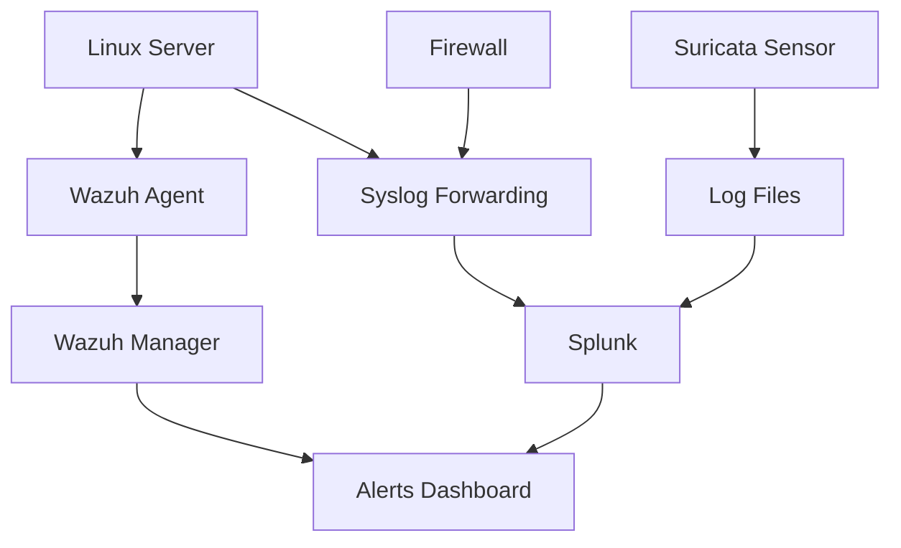

# SIEM and Threat Detection

Status - Lab template to be completed. This repo is a hands-on lab plan for learning SIEM tools and threat detection. It is not production experience and it is not a completed project. Work through the labs, take your own screenshots, and update the status line of each lab as you finish it.

## Objective

Learn how a SIEM turns raw logs into alerts you can act on. Build a small lab with Splunk and Wazuh, feed it logs from a Linux box and a firewall, write detection searches, and practise triage. The goal is to be able to look at an alert, decide if it is real, and say what happened next.

## Architecture



## Technologies used

- Splunk Free
- Wazuh
- Suricata and Snort
- Syslog and journalctl
- MITRE ATT&CK as a study guide
- Linux log files

## Lab topology

- Splunk server on 192.168.10.60
- Wazuh manager on 192.168.10.61
- Linux server on 192.168.10.50 with a Wazuh agent and syslog forwarding to Splunk
- Suricata sensor on 192.168.10.40 sending alerts to Splunk
- Kali Linux on 192.168.10.10 as the source of test traffic, lab only

## Configuration examples

Install the Wazuh all-in-one package on the manager.

```
curl -sO https://packages.wazuh.com/4.7/wazuh-install.sh
bash wazuh-install.sh -a
```

Start Suricata on the sensor and watch the alerts.

```
suricata -c /etc/suricata/suricata.yaml -i eth0
suricata-update
tail -f /var/log/suricata/fast.log
```

Test Snort with a config check before you run it live.

```
snort -T -c /etc/snort/snort.conf -i eth0
snort -A console -c /etc/snort/snort.conf -i eth0
```

Forward syslog from the Linux server to Splunk with rsyslog. Add this line to the rsyslog config.

```
*.* @192.168.10.60:514
```

Then restart rsyslog.

```
sudo systemctl restart rsyslog
```

Check the logs are arriving on the Splunk server.

```
sudo journalctl -u rsyslog --since today
```

## Splunk searches

Find failed SSH logins and count them by source address.

```
index=main sourcetype=syslog "Failed password" | stats count by src_ip | sort -count
```

Find the top ten source addresses in the firewall logs.

```
index=main sourcetype=firewall | stats count by src_ip | sort -count | head 10
```

Find Suricata alerts and group them by signature.

```
index=main sourcetype=suricata | stats count by alert.signature | sort -count
```

Find DNS queries to unusual names.

```
index=main sourcetype=dns | stats count by query | sort -count
```

Find logins outside working hours.

```
index=main sourcetype=syslog "Accepted password" | eval hour=strftime(_time, "%H") | where hour < 7 OR hour > 19 | table _time user src_ip
```

## Detection use cases

- Brute force login, many failed logins from one address in a short time
- Port scan, one address touching many ports on many hosts
- DNS tunneling, one host making a high number of DNS queries to strange names
- Lateral movement, a new login from a host that never logged in before
- Data exfiltration, a sudden rise in outbound traffic from one host
- Malware callback, a host connecting to an address seen in a threat feed

## MITRE ATT&CK mapping

- Reconnaissance, port scanning, look for Nmap traffic and repeated connection attempts
- Initial access, brute force logins, look for many failed logins from one address
- Persistence, a new scheduled task or a new service on a server, look for changes to cron or systemd
- Privilege escalation, a normal user suddenly running admin commands, look for sudo use outside the usual pattern
- Discovery, internal scanning from a compromised host, look for new scan traffic from inside
- Lateral movement, logins between servers that never talked before
- Collection, a host reading files it never touched before
- Exfiltration, large uploads to an outside address
- Command and control, a host calling out to an odd address on a regular schedule

## Alert triage workflow

1. Read the alert and note the source, the destination, and the time
2. Check if the source is a known scanner or a normal host
3. Look at the raw logs behind the alert and confirm the activity is real
4. Check if the same source raised other alerts in the same hour
5. Decide if it is a true positive, a false positive, or a benign event
6. Write down the decision and what you did next
7. Tune the rule if it keeps firing on normal traffic

## Incident response fundamentals

1. Prepare, know what normal looks like and have your tools ready
2. Detect, spot the alert and confirm it is real
3. Contain, stop the spread by isolating the affected host
4. Eradicate, remove the cause and close the hole it came through
5. Recover, bring the host back and watch it closely
6. Learn, write down what happened and what you will change

## Implementation steps

1. Install Splunk Free and Wazuh manager on their own VMs
2. Install a Wazuh agent on the Linux server and confirm it shows up in the manager
3. Forward syslog from the Linux server to Splunk and confirm events arrive
4. Start Suricata on the sensor and send its alerts to Splunk
5. Run a test Nmap scan from Kali and find it in Splunk
6. Write one saved search for failed logins and one for port scans
7. Practise the triage workflow on five alerts and write down each decision

## Verification commands

```
sudo systemctl status wazuh-manager
sudo systemctl status splunk
sudo /var/ossec/bin/agent_control -l
tail -f /var/log/suricata/fast.log
sudo journalctl -u rsyslog --since today --no-pager
```

## Troubleshooting scenarios

- No events arrive in Splunk, so check the forwarder is running and the firewall allows the syslog port
- The Wazuh agent never connects, so check the manager address and the enrollment key
- Suricata raises no alerts, so check it is listening on the right interface and the rules are loaded
- A search returns nothing, so check the index name and the time range first
- An alert fires on normal traffic, so tune the threshold and note the change

## Security best practices

- Forward logs to the SIEM, never store them only on the host that made them
- Protect the SIEM itself with a strong password and a firewall
- Keep detection rules simple and tune them when they fire on normal traffic
- Write down every triage decision so the next person can follow it
- Never run attack tools outside the lab

## Learning outcomes

- Feed logs from a Linux server and a firewall into Splunk
- Write SPL searches that answer a real question
- Run Wazuh and read its alerts
- Map an alert to a MITRE ATT&CK technique
- Triage an alert and write down the decision
- Walk through incident response from detection to lessons learned

## Screenshot placeholders

- screenshots/splunk-search.png - Placeholder, add a screenshot of a Splunk search result
- screenshots/wazuh-agents.png - Placeholder, add a screenshot of the Wazuh agents page
- screenshots/alert-triage.png - Placeholder, add a screenshot of an alert with triage notes

## Project status

Lab template to be completed. No lab in this repo is finished yet. Update this section as each lab is done.
